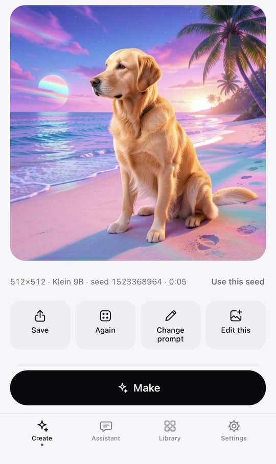
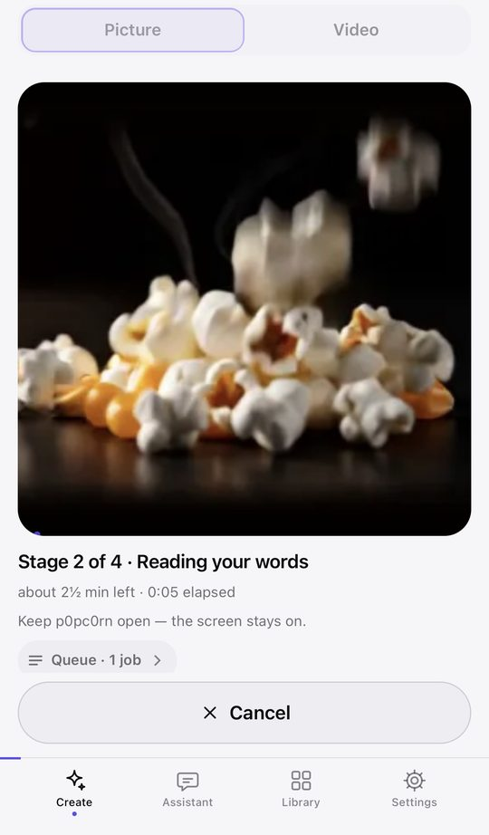
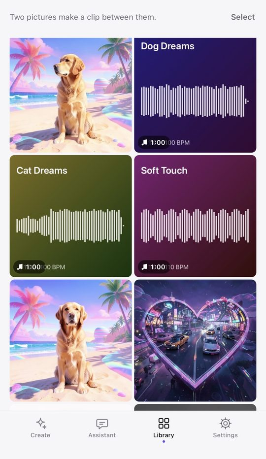
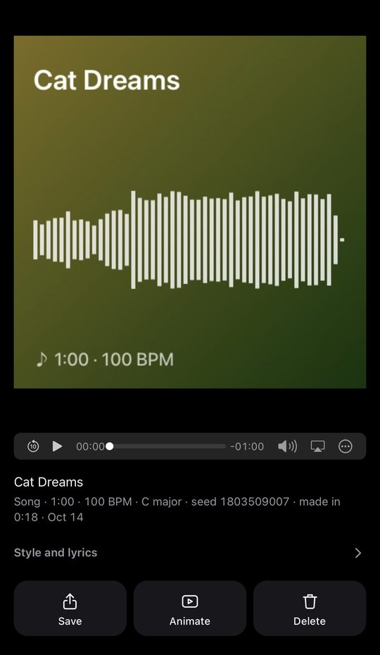

# p0pc0rn

**Make pictures, short videos, songs and music videos on your own phone.**

The models run on the phone's GPU (WebGPU). Your prompts, photos and results stay on the phone. The only things that go online are:
- the model downloads, from Hugging Face (huggingface.co/JoshHughes);
- the words of a lookup, when Juli (the assistant) looks something up on Wikipedia or Fandom (a switch in Settings);
- for a weather question in Juli's chat, only the place's coordinates rounded to about 1 km, to the US National Weather Service
  (api.weather.gov); the place's name and any ZIP code stay on the phone (US places and ZIP codes are found in a US Census Bureau list
  kept on the phone; the same lookups switch);
- for the Nowcast (Experimental), NOAA's radar files for the whole US (rain rate, rain or snow, radar quality) from NOAA's public bucket (noaa-mrms-pds.s3.amazonaws.com: the
  same files for everyone, nothing about you or the place is sent), the map's background pictures from NASA (gibs.earthdata.nasa.gov:
  the map squares on screen, and the GOES satellite's cloud pictures when the Clouds layer is on), and for a place's forecast and
  warnings its rounded coordinates to the US National Weather Service;
- the requests of an app you made or added in Apps, only for the sources you allowed it on its permission sheet: US National
  Weather Service alerts and forecasts (api.weather.gov), US wildfire
  incidents (NIFC, services3.arcgis.com), CoinGecko prices (api.coingecko.com) and Snowtrace, the public Avalanche explorer
  (api.routescan.io: the public addresses you add in Wallet Watch, and a few they deal with, for their public names), and for Token
  Watch DEX Screener (api.dexscreener.com), GeckoTerminal (api.geckoterminal.com), GoPlus (api.gopluslabs.io) and RugCheck
  (api.rugcheck.xyz): the chains you pick and public token addresses, only when you open it or while it watches closely. They carry only what the app asks for, such as a town's position
  rounded to about 1 km or an address; no account, no name. A town or ZIP code typed in an app is found on the phone (a US Census
  Bureau list) and never sent. Apps never see your photos, Library, Cast or files.
- what you search or open in the Browser: p0pc0rn hands it to your phone's own browser, and searches go to DuckDuckGo.

By Joshua Hughes. **Open it at [https://artistjoshhughes.github.io/p0pc0rn/](https://artistjoshhughes.github.io/p0pc0rn/)**: nothing to install, free and non-commercial.

## Screenshots

| Make a picture | Popcorn progress | Library | Songs |
|---|---|---|---|
|  |  |  |  |

*The pictures and songs in these screenshots were made with AI using p0pc0rn.*

## Features

- **Pictures:** FLUX.2 [klein] 4B. Make a picture from words, or edit one of your own.
- **Better pictures (optional):** FLUX.2 [klein] 9B. Slower, better.
- **Videos:** SANA-Video 2.0 5B. Clips of 1 to 5 seconds:
  - from words;
  - from a picture;
  - between two pictures (the picture reader);
  - restyled: a clip of yours re-rendered in one of 20 looks (4.0: the looks LoRA and the clip reader, LTX-2.3's video encoder).
  - An optional video LoRA (4.0) for clips from a picture and between two pictures.
- **Juli, the assistant:** Gemma 4 E2B.
  - It chats, writes prompts and lyrics, and runs the jobs for you.
  - It can look things up on Wikipedia and Fandom, and cites what it used.
  - The starter knowledge works offline.
  - Every conversation is kept (Chats); About me and routines are in Settings › Juli.
  - Faster replies (optional, 54 MB): Google's Gemma 4 drafter guesses a few words ahead and Juli checks them, so the answers
    are the same, only sooner.
  - Bigger brain (optional, 4.7 GB): NVIDIA Nemotron 3.5 Bolt E4B. It plans and writes when you ask Juli to write something or
    to make a picture, clip, song or app; chat stays on her quick model. Text only. On an iPhone it needs iOS 27; not on Android yet.
  - Voice input (optional, 640 MB, 4.0): NVIDIA Nemotron 3.5 ASR Streaming turns your speech into text on the phone, and Juli
    answers out loud in her own voice (p0voice, made for p0pc0rn, 25 MB). On an iPhone it needs iOS 27.
  - Weather (4.0): forecasts and alerts from the US National Weather Service, for a US town or ZIP code found on the phone.
- **Apps:** small apps made from skeletons that run on the phone in a locked sandbox. Juli makes one from a sentence ("a packing list
  for a camping weekend"), or use a skeleton as it is, or import one an AI helper wrote from the downloadable Skeleton Guide.
  - Non-agentic apps are tools you use: tasks and habits, flashcards, a daily counter, a log of numbers, a price dashboard
    (AVAX first; prices from CoinGecko, never advice). Weather Alerts (US National Weather Service) and Wildfire Watch (US wildfire
    incidents) also check on their own while p0pc0rn is open and post notices in Juli's chat.
  - Agentic apps have Juli working in them on her own while p0pc0rn is open: they look things up, re-check, keep a notebook on the
    phone and bring you what needs your eye; only you confirm what they suggest. Trip Watch watches the US forecast and alerts for
    trips you add and tells you what changed. Wallet Watch (beta) watches public Avalanche addresses you add (wallets or contracts) and
    tells you what changed, and Juli describes a wallet's habits; data from Snowtrace, Powered by Routescan.io APIs
    ([routescan.io](https://routescan.io), [@routescan_io on X](https://x.com/routescan_io)); never advice. Token Watch (beta, new in 4.0) shows
    the new tokens that rose most since they launched in the last hour on the chains you pick (Avalanche to start), only ones on a
    real DEX pool, never one still on a bonding curve, with what GoPlus or RugCheck report, and Juli sums it up; "watch closely" keeps an eye on them for 2 hours. Data: [DEX Screener](https://dexscreener.com) · New pools: [GeckoTerminal](https://www.geckoterminal.com) by CoinGecko · Solana checks: [RugCheck](https://rugcheck.xyz) · Powered by [GoPlus Security](https://gopluslabs.io); an Avalanche token's contract on Snowtrace (Powered by Routescan.io APIs) only at your tap, once per token. Not financial advice:
    new tokens are very high risk and many are scams; it cannot trade.
  - Games: Four in a Row, you against Juli; her model picks every move on this phone from the moves the game allows. Troll-E (early
    access, 4.0): a 3D physics game on its own page, with Juli as the hall's mischievous AI.
- **Songs:** ACE-Step 1.5 turbo, with an optional lyrics planner.
- **Music videos** from your songs, storyboarded by Juli.
- **Cast:** people you add with their permission can speak in their own recorded voice (Qwen3-TTS) and appear in pictures and clips.
- **Lip-sync (experimental):** MuseTalk 1.5. Only for consented faces and voices.
- **Home screen:** a dock, names and badges on every icon, a wallpaper you choose, the apps you pin, and a Browser.
- **Music:** a player for your songs, with playlists and controls on the lock screen.
- **Nowcast (Experimental, 4.0):** DeepMind DGMR. The next 90 minutes of rain in the US, from NOAA radar, worked out on the phone.
- **Make HDR (4.0):** an HDR copy (HLG) of a picture, clip or music video beside the original.
- **Not in this build:** LTX-2.3 text-to-video, and sound for clips (still a separate test).

## What's new in 4.0

- **Nowcast (Experimental, US).** The next 90 minutes of rain, worked out on your phone from NOAA's radar: a map with the radar, a
  timeline from the last hour to +90 minutes, places, and the National Weather Service's warnings drawn on it. The model is DeepMind's
  DGMR, trained on UK radar, so it is labelled Experimental and never replaces NWS warnings; the "?" on its card says how accurate it is
  and gives every credit. A Clouds layer (NOAA GOES satellites) is there when you want it. Ask Juli "will it rain in the next hour?" and
  she answers from it. Only the radar files everyone gets, map squares and the place's rounded position go online. How: Nowcast on the
  home screen (the lower 48 states); its model (71 MB or 136 MB) downloads once from its screen, and each nowcast reads about
  7 MB of NOAA radar.
- **Weather in Juli's chat.** Ask about the weather for a US town or a ZIP code: the forecast and any alerts come from the US National
  Weather Service, with a card that opens the place's week and the rain map. The place is found on the phone (a US Census Bureau list);
  only its coordinates, rounded to about 1 km, are sent. How: ask Juli; Settings › Juli › Home ZIP for weather for "here".
- **Restyle a clip.** Pick a clip from the Library or your phone and one of 20 looks (oil paint, clay, anime, stained glass, synthwave,
  ukiyo-e and more): FLUX.2 [klein] makes its first frame in that look for you to check (Use this or Try again), then the whole clip
  is re-rendered in the look, with your clip's own sound. "Follow the motion" sets how closely it keeps your clip's moves (each look
  has its own default). A longer video is restyled as its first 5 seconds, or, Experimental, the whole video in parts up to 20 seconds.
  The result lands in the Library beside the original. How: Create › Video › Restyle a clip; it downloads the looks LoRA (64 MB) and
  the clip reader (LTX-2.3's video encoder, 638 MB, under the same licence sheet as the video model).
- **A video LoRA.** An optional 64 MB add-on for clips from a picture and between two pictures, trained for p0pc0rn on SANA-Video
  2.0. How: Settings › Models › Video LoRA.
- **Talk to Juli.** Tap the mic beside Send: your words appear as you speak, and when you stop the message goes after a short pause,
  with Undo and Edit. Speech recognition runs on the phone (NVIDIA Nemotron 3.5 ASR Streaming, 32 language choices, 640 MB); your voice never
  leaves the phone and is never kept. When you speak, Juli answers out loud: her first sentence while she writes the rest, with a
  waveform while either of you talks, and Stop. Simple sums and unit conversions are worked out exactly before she answers. How:
  Settings › Juli (the switch, "Send when I stop talking", the language, "Juli speaks her replies"); on an iPhone it needs iOS 27.
- **Juli's own voice.** In voice mode Juli speaks with a voice made for p0pc0rn (p0voice, 25 MB, trained by the p0pc0rn project; no
  real person's voice). It downloads by itself the first time she speaks; until then, and without WebGPU, she speaks with Flite.
  Settings › Models › Juli's voice has its row.
- **Troll-E (early access).** A 3D game with real physics: you are a01, a trash trolley in a run-down reclaim hall. Level 1 teaches
  you to drive, crab, spin and grab, and ends at the top of the stairs; then the hall opens onto a world to scavenge, craft 24 strange
  machines, build a shelter and survive the night's energy leeches. Juli is the hall's mischievous AI on the radio and plays against
  you on her own model, on your phone; with the Bigger brain downloaded, it can plan her shift while the game loads. How: Games › On your
  own › Troll-E › Play. It runs on its own page; Back opens p0pc0rn again.
- **Make HDR.** A picture, a clip or a music video gets an HDR copy (HLG) beside the original: Vivid (brighter highlights, richer
  colour) or Bright (the whole picture lifted), with a before and after to compare. How: open it in the Library › Make HDR.
- **A speed tune for your device.** p0pc0rn can time Juli's kernels on your own phone or computer and keep the fastest ones that pass
  its correctness check. How: the pop-up when it offers, or Settings › Benchmark › Speed › Tune for this device. On a laptop with two
  graphics chips p0pc0rn asks for the faster one, and Settings › About › Graphics names the chip in use.
- **Token Watch (beta).** An app that works for you: the new tokens that rose most since they launched in the last hour on the chains
  you pick, with what GoPlus or RugCheck report and Juli's summary; "watch closely" keeps an eye on them for 2 hours. Never advice;
  it cannot trade. How: Apps › Works for you › Token Watch (beta) › Get.
- **One schedule for your apps.** The apps that check on their own take turns by the priority you give them, share Juli's model
  when they need it, and stay inside each source's limits. How: Settings › Apps › Priority.
- **Home screen.** Messages joins the dock (coming soon), and Settings moves to the home screen. Connection: coming soon.
- **Juli knows your Cast.** People who added themselves in Cast can be made by name in a picture or clip.
- **Safer.** A job Juli started from the chat has a Stop on its message. An app that ended the page waits for you at the next start
  instead of opening again. Importing an app design or a skill says plainly that it changes what Juli does.
- **The Library's clip row** is Save, Restyle, Reuse, More, Make HDR and Delete (Lip-sync is under More).

## What's new in 3.9

- **A home screen.** p0pc0rn now opens on a home screen of its own (a new install still starts in Juli's chat, which offers her
  download). It scrolls up and down. The dock at the bottom holds Juli, Create, Music and Settings (the gear), and the p0pc0rn
  pill just above the dock opens Juli. Every icon has its name under it, and a red number at its top left counts what's new:
  results you haven't seen on Create, Juli's unread replies, what an app wants you to review, new songs on Music. When an app that
  works for you has something for you, its card sits at the top; swipe it away and it comes back only with something new. How: tap
  an icon; swipe in from the left edge to come back home.
- **Make it yours.** Press and hold an icon and the icons wiggle: drag one to move it, − removes an app you pinned, and Wallpaper
  sets the picture behind the icons (one from your Library or a photo, shown slightly blurred so the icons stay sharp). How: press
  and hold an icon; Done when you're finished.
- **Your own apps on the home screen.** An app you made can sit on the home screen with a letter icon of its own, if you want it
  there. How: Apps › My apps › Add to Home.
- **Browser.** A search box and bookmarks. Links open in your phone's own browser sheet (tap Done there to come back), and searches
  go to DuckDuckGo. How: Browser on the home screen.
- **Connection:** coming soon.
- **Juli's chat reads like text messages.** Yours on the right, Juli's on the left, with dots while she works and her words arriving
  as she writes them; pictures, clips and songs sit in the conversation. Under a result, option bubbles run what p0pc0rn already does
  with it: Make again, Edit this, Animate, Clip to another picture, Save, Open in Library (for a song: Make again, Animate, Save as
  .m4a or .wav). How: tap a bubble under the result.
- **Chats.** Every conversation is kept on the phone, newest first, with what's unread; your chats from 3.8 are there too. How:
  Juli › Chats; the pencil starts a new chat; swipe left on a chat, or press and hold it, to delete it (what Juli made stays in the
  Library).
- **Music.** Your songs in one place, with playlists, shuffle and repeat, playing on with the screen locked, with its controls on
  the lock screen. How: Music in the dock › Play; Playlists › New playlist.
- **Games: Juli plays.** Four in a Row comes with p0pc0rn: you against Juli, on this phone, with sound and the score across games.
  Juli plays to win and every move is her own: the game reads every column many moves ahead and gives her that read, and her model
  picks. Beat her 10 times in a row to unlock a new opponent: Juli with the Bigger brain. How: Games on the home screen › Four in a
  Row › Play. A new game for p0pc0rn: the Skeleton Guide's Game Kit, with an AI helper.
- **Skills: know-how for Juli.** A skill is a short text that teaches Juli how to do something; it has no screen and no code. Five
  come with p0pc0rn (making an app, changing an app, playing Four in a Row, making a game, watching a wallet), and you can add your own. How: Skills on the home screen
  › Import a skill (.md); in a chat, "use my <name> skill" picks one.
- **Change an app by asking.** Say what to change in plain words: Juli plans it, makes the change, runs the app to check it and
  shows what changed. How: Apps › My apps › Change › Change it; Undo the last change, or Versions for an earlier one.
- **About me and routines.** About me (up to 1,200 characters) tells Juli about you; she fits her answers to it and may use it when she makes or changes an
  app for you; apps themselves never read it. Routines (up to five) are messages Juli runs for you while p0pc0rn is open: when it opens, every few hours, or daily at a time
  you set. How: Settings › Juli › About me, or Routines.
- **Wallet Watch (beta): Juli keeps an eye on public Avalanche addresses.** Paste a wallet or a contract address (or keep the public WAVAX
  example): while p0pc0rn is open it looks at most every 15 minutes (every 30 to start), only when your phone is idle (never while
  Juli answers you or a picture, song or clip is being made), on Snowtrace, the public explorer, and tells you what changed in its
  list and in Juli's chat: AVAX and tokens in and out, a contract that is busier than usual or whose code changed. Once a day Juli
  describes a wallet's habits from its public history: when it is active, what it deals with, typical sizes. Her words are kept
  only when every number is Snowtrace's; never advice, never a guess about who is behind an address. Only public addresses go online: the ones you add, and once a day a few they deal with most, for their public names.
  p0pc0rn's hard cap stays at half of Snowtrace's free limit per device: it reads Snowtrace only when opened from the Home Screen, and
  each copy sends at most one request every 2 seconds and 2,500 a day for all your apps, 1,600 for any one, so even two copies on one
  phone stay within half (the app's settings show today's count). Data: Snowtrace, Powered by Routescan.io APIs
  ([routescan.io](https://routescan.io), [@routescan_io on X](https://x.com/routescan_io)).
  How: Apps › Works for you › Wallet Watch (beta) › Get; Add to Home Screen if you like.
- **Ten skeletons** come with p0pc0rn: Four in a Row and Wallet Watch join the eight from 3.8.
- **Juli answers everyday questions.** Ask her anything, like "how do I get a red wine stain out?" or "who created Spider-Man?":
  she looks facts up on Wikipedia and Fandom and shows her sources, gives how-tos as steps, and says when she isn't sure instead of
  guessing. When no source says a food is safe for a pet, she tells you to ask a vet first. How: ask in Juli's chat.
- **Clips show a poster.** In Juli's chat and the Library, a clip shows a frame from it with a play button. How: tap it to play.
- **Settings in groups.** Settings opens on a short list of groups; tap one to open it. Cast, your own voice and lip-sync
  recordings, also has its own icon on the home screen. How: the gear in the dock; Cast on the home screen.
- **Made apps fit the phone.** An app starts right under p0pc0rn's bar, with no empty band over its title, and its buttons sit just
  above the bottom of its space.
- **The whole screen on iOS 27.** In the Home Screen app, iOS 27 left a blank strip at the bottom of every screen (an iOS bug for
  web apps that draw under the status bar). p0pc0rn now reaches the bottom edge again, with no need to add it to the Home Screen
  again. Settings › About › Diagnostics shows what your phone did.
- **Fixed: Tiles Log keeps what you log.** In 3.8 it never saved its entries; now it does.
- **Settings › Benchmark › Full** now also checks every feature and gives each one a pass or a fail; the Music check tests playback
  with the screen locked. Copy the results to share them. Nothing is sent.
- **New icons and a new wallpaper,** made for p0pc0rn with AI ([NOTICE.md](NOTICE.md)).

## What's new in 3.8

- **The assistant is called Juli.**
- **A faster Juli.** On an iPhone 16 Pro Max, compared with 3.7: chat answers come about 1.6× as fast, tool calls more than twice
  as fast, and a long prompt is read in about half the time. The words are the same.
- **Faster replies** (Google's Gemma 4 drafter, 54 MB) comes with Juli's download. A phone that already has Juli is offered it once,
  and Settings › Models has it.
- **Juli's Bigger brain (optional, 4.7 GB):** NVIDIA Nemotron 3.5 Bolt E4B, a bigger model for thinking and writing. With it on the
  phone, when you ask Juli to write something, or to make a picture, clip, song or app, her quick model looks things up and checks
  pictures, then the Bigger brain plans and writes. Chat stays on the quick model, so it stays snappy. Only one model fits in memory
  at a time, so these jobs take a few seconds longer to start. Settings › Juli › "Bigger brain for writing and making" turns it off.
  It reads text only, needs iOS 27 on an iPhone (or a computer: Chrome or Edge, or Safari 27 on a Mac), and is not offered on
  Android yet.
- **Two processes, one model (iOS 27).** Safari gives a web page about 1.8 GB of memory, and the Bigger brain needs about 3 GB. So
  on iOS 27 p0pc0rn splits a model in two: a helper started by p0pc0rn's own service worker runs the first layers in a process of
  its own, with its own share of the phone's memory, and the page runs the rest, passing each token across. That is how the Bigger
  brain fits at all (about 1.6 GB in the page and 1.4 GB in the helper), and why Juli has room for faster replies next to a long
  prompt. The service worker serves only that one helper file; it stores nothing, and every other request goes to the network as
  before. The answers are the same. How it works: [Two processes, one model](docs/TWO-PROCESSES.md).
- **The Apps tab:** make an app by saying what you want, use one of the skeletons that come with p0pc0rn, or import your own.
  An app answers the tap; an agentic app keeps going: Juli works in it on her own while p0pc0rn is open, like Trip Watch, which
  watches the weather for your trips. **Download the Skeleton Guide** and give it to an AI helper such as Claude to write a new
  skeleton; it has a complete agentic example to copy.
- **Settings › Benchmark:** Quick (about 3 minutes: Juli and the apps, about 4 with the Bigger brain) or Full (about 13–16 minutes: + a long answer from each model, a picture, a clip and a song) shows how fast your phone runs p0pc0rn; Copy the
  results to share them. Nothing is sent.

## Get started

1. **On your phone, open [https://artistjoshhughes.github.io/p0pc0rn/](https://artistjoshhughes.github.io/p0pc0rn/).**
   - **iPhone:** Safari, iOS 26 or later (iOS 27 for the Bigger brain). Add it to your Home Screen first (Share › Add to Home Screen) and open p0pc0rn from the icon:
     iOS keeps the Home Screen app's storage apart from Safari's, so download your models there.
   - **Android (Chrome): experimental.** Prepared on desktop with Android-like limits; not yet tested on an Android phone.
     Run Settings › About › Device check first.
2. Read the rights lesson and tap **I agree**.
3. **Download what you want.** p0pc0rn opens in Juli's chat, which offers its own download first and the other models when
   you ask for them; **Settings › Models** has every model. Each model shows its licence first. Sizes and tips: [SETUP.md](SETUP.md).

Running your own copy is optional, and the licence allows it only for yourself, on your own devices. [SETUP.md](SETUP.md) has the
steps; with Claude Code, open the folder and say "set up p0pc0rn with me" ([CLAUDE.md](CLAUDE.md)).

## Licence, in short

p0pc0rn is source-available, non-commercial software. [LICENSE.md](LICENSE.md) is the p0pc0rn Non-Commercial License 1.2;
the file governs. In short:

- **Use the official site, or run your own copy only for yourself.** Don't host it for anyone else, free or paid.
- **No commercial use of the app.** Don't sell it, charge for it, or put ads in it.
- **Your outputs are yours.** Where the law allows, you may use them commercially, subject to each model's licence
  ([MODELS.md](MODELS.md)). For example:
  > FLUX.2 klein 9B is under Black Forest Labs' FLUX Non-Commercial License. BFL says you may use outputs "for any purpose
  > (including for commercial purposes)" (§2(d)), and limits use of the model itself to non-commercial purposes (§1(c), §4(a)).
  > Read the licence before using it for business. The 4B model is Apache-2.0.
- **Forks get their own name and icon,** and show "Based on p0pc0rn by Joshua Hughes" with a link to the official site, in
  their own screens and at the top of their README, for as long as copyright lasts. That goes for any part, port or
  translation too ([LICENSE.md](LICENSE.md) section 3.6, [TRADEMARKS.md](TRADEMARKS.md)).
- **The safeguards stay in:**
  - the rights lesson;
  - the agreement;
  - the tick on every upload;
  - the consent checks.
- **Follow the [use policy](USE-POLICY.md)** and "the laws of the State of Oregon, and the laws where you are". That means no
  infringement, and no likeness, voice or lip-sync of anyone without their consent.
- **Say it's AI-generated** when you share what you made, for example "Made with AI using p0pc0rn".

Model licences: [MODELS.md](MODELS.md). Notices: [NOTICE.md](NOTICE.md). Full texts: `licenses/`.

**Official Distribution** (LICENSE.md section 1): **https://artistjoshhughes.github.io/p0pc0rn/**, published from this repository
([github.com/ArtistJoshHughes/p0pc0rn](https://github.com/ArtistJoshHughes/p0pc0rn)). Only Joshua Hughes changes this address.

## Contact

- X: **[@p0pc0rnapp](https://x.com/p0pc0rnapp)** (official) and **[@joshhughes___](https://x.com/joshhughes___)** (Josh).
- Bugs and feedback: [GitHub issues](https://github.com/ArtistJoshHughes/p0pc0rn/issues) on this repository. Issues are public: leave out
  personal photos, voices, anyone's likeness and anything private.
- Security problems: [SECURITY.md](SECURITY.md).

## Road map

- 🖼️ FLUX 3 [klein] image model as the Better picture option.
- 🔊 Sound for clips: sound effects made with your videos.
- ✈️ Complete airplane mode (coming soon): once p0pc0rn is on your Home Screen it runs fully offline, and updates only when you choose.
- 👀 Live Preview of renders: watch your picture or video take shape while it renders.
- 👄 More LoRAs for SANA video (4.0 has the first two), next a lip-dub LoRA like LTX's.
- 🎬 Animated cartoons, sitcoms and cinema, rendered locally and free on your own device.
- 🎷 Labs: experimental features, starting with Playing Jazz — give it one idea and the AI improvises a short film, each clip picking up from the last frame of the one before, scored with an instrumental track.
- 📲 Push notifications for agentic apps: alerts even when p0pc0rn is closed.
- 🔄 Updated workflows.
- 🐞 Debugging.
- ✨ More features.

The app is updated periodically, when Josh Hughes decides to.

---

p0pc0rn™ © 2026 Joshua Hughes. The models are by their publishers, under their own licences.
