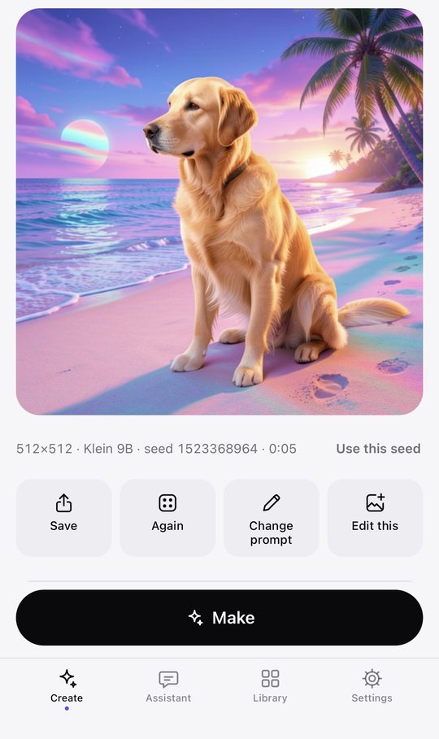
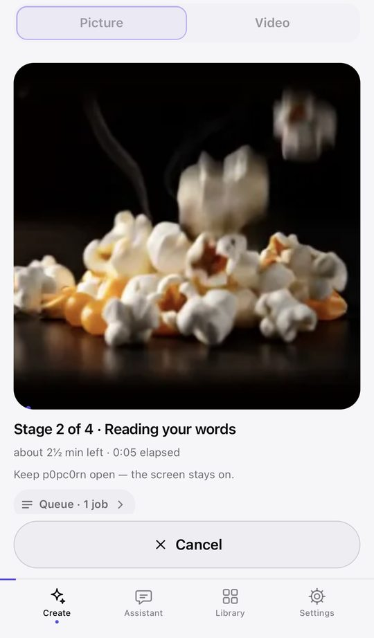
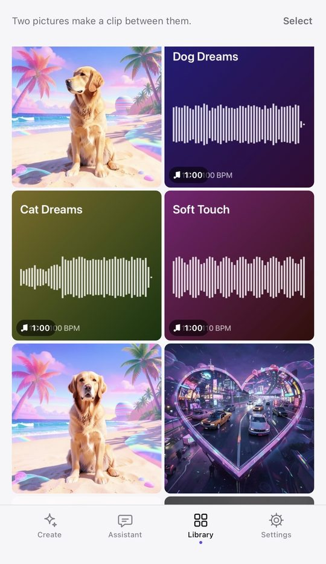
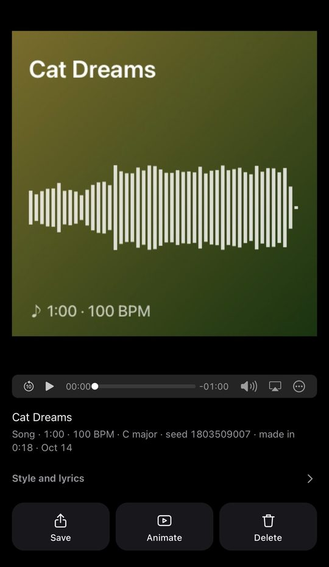

# p0pc0rn

**Make pictures, short videos, songs and music videos on your own phone.**

The models run on the phone's GPU (WebGPU). Your prompts, photos and results stay on the phone. The only things that go online are:
- the model downloads, from Hugging Face (huggingface.co/JoshHughes);
- the words of a lookup, when the assistant looks something up on Wikipedia or Fandom (a switch in Settings).

By Joshua Hughes. **Open it at [https://artistjoshhughes.github.io/p0pc0rn/](https://artistjoshhughes.github.io/p0pc0rn/)**: nothing to install, free and non-commercial.

## Screenshots

| Make a picture | Popcorn progress | Library | Songs |
|---|---|---|---|
|  |  |  |  |

*The pictures and songs in these screenshots were made with AI using p0pc0rn.*

## Features

- **Pictures:** FLUX.2 [klein] 4B. Make a picture from words, or edit one of your own.
- **Better pictures (optional):** FLUX.2 [klein] 9B. Slower, better.
- **Videos:** SANA-Video 2.0 5B. Clips of 1 to 5 seconds:
  - from words;
  - from a picture;
  - between two pictures (the picture reader).
- **Assistant:** Gemma 4 E2B.
  - It chats, writes prompts and lyrics, and runs the jobs for you.
  - It can look things up on Wikipedia and Fandom, and cites what it used.
  - The starter knowledge works offline.
- **Songs:** ACE-Step 1.5 turbo, with an optional lyrics planner.
- **Music videos** from your songs, storyboarded by the assistant.
- **Cast:** people you add with their permission can speak in their own recorded voice (Qwen3-TTS) and appear in pictures and clips.
- **Lip-sync (experimental):** MuseTalk 1.5. Only for consented faces and voices.
- **Not in this build:** LTX-2.3 text-to-video, and sound for clips (still a separate test).

## Get started

1. **On your phone, open [https://artistjoshhughes.github.io/p0pc0rn/](https://artistjoshhughes.github.io/p0pc0rn/).**
   - **iPhone:** Safari, iOS 26 or later. Add it to your Home Screen first (Share › Add to Home Screen) and open p0pc0rn from the icon:
     iOS keeps the Home Screen app's storage apart from Safari's, so download your models there.
   - **Android (Chrome): experimental.** Prepared on desktop with Android-like limits; the first device test (Pixel 10) is pending.
     Run Settings › About › Device check first.
2. Read the rights lesson and tap **I agree**.
3. **Settings › Models:** download what you want. Each model shows its licence first. Sizes and tips: [SETUP.md](SETUP.md).

Running your own copy is optional, and the licence allows it only for yourself, on your own devices. [SETUP.md](SETUP.md) has the
steps; with Claude Code, open the folder and say "set up p0pc0rn with me" ([CLAUDE.md](CLAUDE.md)).

## Licence, in short

p0pc0rn is source-available, non-commercial software. [LICENSE.md](LICENSE.md) is the p0pc0rn Non-Commercial License 1.1;
the file governs. In short:

- **Use the official site, or run your own copy only for yourself.** Don't host it for anyone else, free or paid.
- **No commercial use of the app.** Don't sell it, charge for it, or put ads in it.
- **Your outputs are yours.** Where the law allows, you may use them commercially, subject to each model's licence
  ([MODELS.md](MODELS.md)). For example:
  > FLUX.2 klein 9B is under Black Forest Labs' FLUX Non-Commercial License. BFL says you may use outputs "for any purpose
  > (including for commercial purposes)" (§2(d)), and limits use of the model itself to non-commercial purposes (§1(c), §4(a)).
  > Read the licence before using it for business. The 4B model is Apache-2.0.
- **Forks get their own name and icon,** and keep "Based on p0pc0rn by Joshua Hughes" ([TRADEMARKS.md](TRADEMARKS.md)).
- **The safeguards stay in:**
  - the rights lesson;
  - the agreement;
  - the tick on every upload;
  - the consent checks.
- **Follow the [use policy](USE-POLICY.md)** and "the laws of the State of Oregon, and the laws where you are". That means no
  infringement, and no likeness, voice or lip-sync of anyone without their consent.
- **Say it's AI-generated** when you share what you made, for example "Made with AI using p0pc0rn".

Model licences: [MODELS.md](MODELS.md). Notices: [NOTICE.md](NOTICE.md). Full texts: `licenses/`.

**Official Distribution** (LICENSE.md section 1): **https://artistjoshhughes.github.io/p0pc0rn/**, published from this repository
([github.com/ArtistJoshHughes/p0pc0rn](https://github.com/ArtistJoshHughes/p0pc0rn)). Only Joshua Hughes changes this address.

## Contact

- X: **[@p0pc0rnapp](https://x.com/p0pc0rnapp)** (official) and **[@joshhughes___](https://x.com/joshhughes___)** (Josh).
- Bugs and feedback: [GitHub issues](https://github.com/ArtistJoshHughes/p0pc0rn/issues) on this repository. Issues are public: leave out
  personal photos, voices, anyone's likeness and anything private.
- Security problems: [SECURITY.md](SECURITY.md).

## Road map

- 🖼️ FLUX 3 [klein] image model as the Better picture option.
- 🔊 Sound for clips: sound effects made with your videos.
- ✈️ Complete airplane mode (coming soon): once p0pc0rn is on your Home Screen it runs fully offline, and updates only when you choose.
- 👀 Live Preview of renders: watch your picture or video take shape while it renders.
- 👄 LoRAs for SANA video, starting with a lip-dub LoRA like LTX's.
- 🎬 Animated cartoons, sitcoms and cinema, rendered locally and free on your own device.
- 🎷 Labs: experimental features, starting with Playing Jazz — give it one idea and the AI improvises a short film, each clip picking up from the last frame of the one before, scored with an instrumental track.
- 🔄 Updated workflows.
- 🐞 Debugging.
- ✨ More features.

The app is updated periodically, when Josh Hughes decides to.

---

p0pc0rn™ © 2026 Joshua Hughes. The models are by their publishers, under their own licences.
